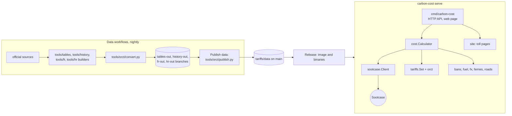

# carbon-cost: code documentation

This is the documentation for working on carbon-cost's code. The [README](../../README.md) is for using it: what it prices, the request fields and the rates it has.

carbon-cost prices what a truck trip pays for carbon and road charges: km-based road tolls by country (with their CO2 part), tolls at stations, on sections, bridges and tunnels, environmental zones, the EU and UK ETS on ferry crossings, national CO2 prices on diesel, and ETS2 on road fuel from 2028. Around those it gives the trip's fuel or electricity cost, its driving bans, its emissions (from [Sootcase](https://sootcase.org)), and each shipment's share.

| Page | What it covers |
|---|---|
| [request-flow.md](request-flow.md) | What happens to a request, step by step, from the HTTP handler to the response |
| [packages.md](packages.md) | Every Go package: what it is for, its files, its main types and functions, its data and tests |
| [data-pipeline.md](data-pipeline.md) | How the rate tables and other data are fetched, built, converted to ORCT and published (`tools/`, the data workflows and branches) |
| [operations.md](operations.md) | CI, the tests that hold the figures to their sources, releases, the Sootcase live checks, the branches, and how this documentation is checked |

## Principles the code keeps

- **Every number has a source.** A rate is a published rate, from a law or the authority that sets it, cited in the dataset; a price is the user's, an official statistic (the EU Weekly Oil Bulletin, Eurostat, the ECB), or Sootcase's GLEC / EN ISO 14083 result. Nothing is fitted or guessed. Where a rate is an estimate (Italy's motorway tolls), the dataset says so.
- **ORCT only.** The calculator reads its toll, crossing, zone and fuel CO2 rates only as ORCT 0.3 datasets (`tariffs/data`, package `orct`). The data workflows convert whatever they fetch to ORCT right after building it (`tools/orct/convert.py`).
- **Every data step is repeatable.** Each dataset is built by a script from fetched official sources, in a GitHub Actions workflow. Pages that refuse scripted requests were read in Chrome and saved with their URL and date (`tools/tables/browser/`); the scripts read those copies.
- **Sootcase is a black box.** carbon-cost calls Sootcase's public API (package `sootcase`) for routes, distances by country and emissions, and tests what it needs from it with the live checks (`tools/livecheck`), never by reading its code.

## Layout

```
cmd/carbon-cost/     the command: calc, serve, rates, report; the HTTP API and the web page (web/)
cost/                the calculator: routes a trip, prices it, shares it out
orct/                ORCT 0.3: reads datasets, prices usages (clause 8 of the specification)
tariffs/             the embedded ORCT datasets (tariffs/data/<cc>/*.orct.json) as a searchable set
bans/                driving bans and public holidays by country (bans/data: dated calendars)
fuel/                diesel prices (Weekly Oil Bulletin, national sources), electricity prices, excise refunds
fx/                  exchange rates (ECB, National Bank of Serbia, Bank of Albania)
ferries/             ferry crossings, their ships' EU MRV emissions, ETS coverage and surcharges
roads/               OpenStreetMap motorways and national roads by country, to tell road classes apart
rates/               the truck and the names the price lines use
sootcase/            the Sootcase API client
site/                the public toll pages (/tolls, /tolls/<cc>, ...) in 32 languages
internal/apidoc/     writes the OpenAPI description from the Go types
tools/               the data tools (Python) and three Go commands (mrvferries, openapi, docs/godoc)
docs/requirements/   what carbon-cost needs from Sootcase, with the checks for each
.github/workflows/   CI, releases and the data workflows
```

## How the parts fit



## Build, test and run

```
go build ./cmd/carbon-cost
go test ./...                      # needs no network: Sootcase is faked
go vet ./... && gofmt -l .         # CI requires both clean
go run ./tools/openapi             # after changing the request or response types
python3 tools/docs/check.py        # after changing this documentation (see operations.md)
go run ./tools/docs/godoc          # every exported name has a doc comment

carbon-cost calc -from DKCPH -to DEHAM -mass-kg 40000 -axles 5 -euro 6 -co2-class 1 -cargo-kg 20000
carbon-cost serve -addr :8090      # web page at /, API at /v1/..., toll pages at /tolls
carbon-cost rates                  # the datasets embedded
```

`calc` and `serve` call Sootcase at `SOOTCASE_URL` (default `https://sootcase.org`) with `SOOTCASE_API_KEY`; a trip given by `-country-km` doesn't call it.
