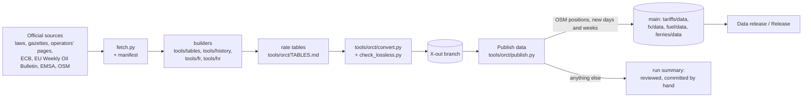

# How the data gets in

Every figure carbon-cost prices with is built by a workflow from an official source, so any run can be repeated and its inputs checked. Nothing is typed into the datasets by hand: where a source can't be fetched by a script, its text is transcribed or read in Chrome into a file that a builder reads (and a check compares again with the source where it can).

## The data workflows

Each runs on a schedule and when its trigger branch is pushed to, and force-pushes everything it fetched and built to its own output branch, with a `manifest.json` of every file it fetched (URL, sha256, size, time, HTTP status). A source that fails in a run keeps the last run's copy (`tools/history/reuse.py`), and the run says so.

| Workflow | When (UTC) | Run by pushing to | Output | What it builds |
|---|---|---|---|---|
| Tables data (`.github/workflows/tables-data.yml`) | daily 01:23 | `tables-data` | `tables-out` | The current toll tables of most countries, crossings, ferries, zones and fuel CO2 prices (`tools/tables/*.py`, sources in `tools/tables/sources.json`); the ferry crossings, ships and ETS surcharges (`tools/tables/ferry_ships.py`, `tools/tables/ets_islands.py`, `tools/tables/ferry_ets.py`) |
| Croatia data (`.github/workflows/hr-data.yml`) | daily 02:37 | `hr-data` | `hr-out` | HAC's tolls with Croatia's booths and junctions (`tools/hr/build.py`) |
| France data (`.github/workflows/fr-data.yml`) | daily 02:49 | `fr-data` | `fr-out` | The French motorway companies' tariffs and stations (`tools/fr/`, see `tools/fr/README.md`) |
| History data (`.github/workflows/history-data.yml`) | daily 03:41 | `history-data` | `history-out` | Earlier versions of the tables, from archived or still-served official texts (`tools/history/build_*.py`, `tools/history/wayback.py`, sources in `tools/history/sources.json`); the ECB's, NBS's and BoA's exchange rates (`tools/history/ecb.py`, `tools/history/nbs.py`, `tools/history/boa.py`); the Weekly Oil Bulletin (`tools/history/wob.py`) and Eurostat's power prices (`tools/history/eurostat_power.py`) |
| National diesel prices (`.github/workflows/national-diesel.yml`) | Fridays 05:17 | (by hand) | its log | `fuel/data/national-diesel.csv` for GB, NO and CH (`tools/history/national_diesel.py`) |
| Roads data (`.github/workflows/roads-data.yml`) | | `roads-data` | `roads-out` | `roads/data/<cc>.json.gz` from Geofabrik's OSM extracts (`tools/roads/build.py`; Poland's legal network, `tools/roads/pl_network.py`) |
| MRV ferry data (`.github/workflows/mrv-data.yml`) | | `mrv-data-run` | `mrv-data` | `ferries/data/mrv-ropax-<year>.json` and `mrv-ships-<year>.json` from EMSA's MRV report (`tools/mrvferries`) |

A builder that fails (a page that changed shape, an Overpass answer short of booths) is reported and the others still run; the run fails at the end, so GitHub mails the owner.

## From a table to a dataset

The builders write rate tables in carbon-cost's own format (`tools/orct/TABLES.md`). `tools/orct/convert.py` converts each to an ORCT 0.3 dataset, and `tools/orct/check_lossless.py` checks that the dataset holds every figure the table does. `tools/orct/compare.sh` then says, for each, whether it is the same as the one in `tariffs/data`.

Text that can't be fetched by a script:

- **Transcribed** (`tools/tables/transcribed`, `tools/history/transcribed`, `tools/fr/transcribed`): tables typed from a PDF or a scan, each with its source. `tools/tables/check_transcribed.py` checks every figure against the fetched text in each Tables data run.
- **Read in Chrome** (`tools/tables/browser`, `tools/history/browser`, `tools/fr/browser`): pages that refuse scripts (bot checks, Cloudflare). Each file starts with its URL and the day it was read. `tools/tables/check_browser.py` knows when each must be read again; the weekly Pages read in Chrome workflow (`.github/workflows/browser-pages.yml`) fails when one is due.
- **Driving bans** (`bans/data`): the yearly decrees' days, transcribed, or generated from the decree (`tools/tables/es_bans.py`), and checked against the decrees' text by `tools/tables/check_bans.py`: in each Tables data run and, quickly, in Bans check (`.github/workflows/bans-check.yml`).

## Publishing to main

Publish data (`.github/workflows/publish-data.yml`) runs after each of the four daily data workflows (`workflow_run`) and takes its output branch:

- datasets that differ from `tariffs/data` only in what OpenStreetMap gives (positions, booth names, headings, the extract's date), ferry crossing files that differ only in the terminals' positions, and exchange rate and fuel price files that only add days or weeks after their last are committed to main (`tools/orct/publish.py`, tested by `tools/orct/test_publish.py`);
- any other change, and any new dataset, is listed in the run's summary. It is checked against its source and committed by hand.

It also lists the schemes whose last dataset ends within 45 days with nothing after it (`tools/orct/expiring.py`), so a new year's tariffs are added before the old ones run out. At run time, `Set.Lapsed` and the response's `missing` say the same for a trip.

Data release (`.github/workflows/data-release.yml`, Mondays 05:47) raises `RELEASE`'s patch number when only data changed since the last release, which starts Release: see [operations.md](operations.md).

## Other tools

| Tool | What it does |
|---|---|
| `tools/tables/fetch.py` | Fetches a `sources.json` (pages, PDFs, APIs, Overpass queries over several instances) into a directory with its manifest |
| `tools/history/committed.py` | What the history builders know of the committed datasets (names, dates), to end a historical table the day before the next version |
| `tools/rs/gazette_ocr.py` | OCR of the Serbian toll decision's scanned tables |
| `tools/site/locales.py` | `site/i18n/locales.json`: each language's formats and country names from the Unicode CLDR |
| `tools/site/font_atlas.py` | The glyph atlas the share images are drawn with |
| `tools/openapi` | Writes `cmd/carbon-cost/web/openapi.json` from the Go types |
| `tools/livecheck/sections.py`, `tools/livecheck/restrictions.py`, `tools/livecheck/vehicle_types.py` | Black-box checks of Sootcase (see [operations.md](operations.md)) |
| `tools/docs/check.py`, `tools/docs/godoc` | The documentation checks |
