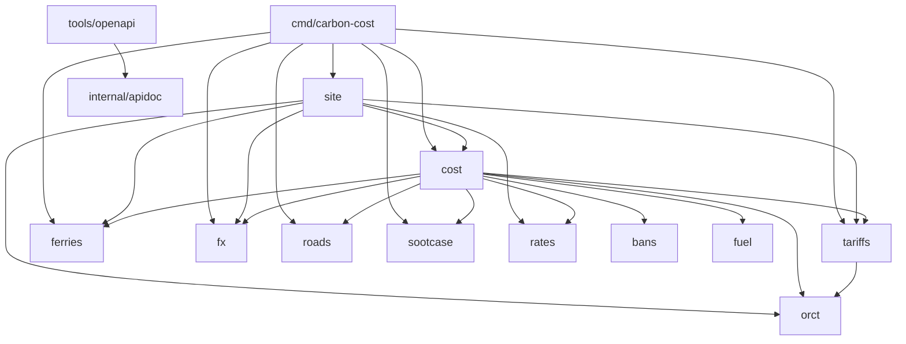

# Packages

The Go module is `github.com/majidkabir/carbon-cost` (Go 1.24). Its one outside dependency is `github.com/majidkabir/sootcase`, for `pkg/borders`: the Natural Earth borders and the rule Sootcase uses to split a route by country, so carbon-cost's split matches Sootcase's `country_km`.

Who imports whom:

`bans`, `fuel`, `fx`, `ferries`, `orct`, `rates`, `roads` and `sootcase` import nothing of the module: each holds one kind of data or one outside interface.

Every exported identifier has a doc comment; `go doc ./<package>` shows them. This page says what each package is for and how its parts fit.

## cmd/carbon-cost

The command and the HTTP service.

| File | What it does |
|---|---|
| `cmd/carbon-cost/main.go` | Subcommands `calc`, `serve`, `rates`, `report`; the `calc` flags (`parseCalcWith`) and their output (`printResult`); the HTTP handler (`handlerAt`); `calculator` builds the `cost.Calculator` |
| `cmd/carbon-cost/batch.go` | Several trips at once: a CSV with a column per `calc` flag (`priceCSV`, `calc -csv`, `POST /v1/carbon-cost/csv`) and a JSON batch (`priceAll`, `POST /v1/carbon-cost/batch`), each row and shipment written back (`csvResult`, `csvShipment`) |
| `cmd/carbon-cost/report.go` | `report`: sums the CSV results by columns (`summarize`); also `POST /v1/carbon-cost/report` |
| `cmd/carbon-cost/path.go` | Reads a truck's own track (`-path`): GPX track or route points, or JSON: a list of `[lon, lat]` points or GeoJSON lines (`readPath`) |
| `cmd/carbon-cost/rfms.go` | Reads rFMS vehicle positions and status reports for one VIN (`readRFMS`): the track, the diesel or electricity used, the odometer km and the times |
| `cmd/carbon-cost/web/index.html` | The calculator page, in eight languages (its `I18N` table); `openapi.json` the API description; `leaflet/` the map library |

HTTP routes (`handlerAt`): `GET /` the page, `GET /healthz`, `GET /v1/openapi.json`, `GET /v1/rates` and `GET /v1/rates/{cc}/{file}` (the datasets), `GET /v1/places` (Sootcase's place search), `POST /v1/carbon-cost`, `/batch`, `/csv`, `/report`; and the toll pages (`site.Site.Register`).

Settings (flags, or environment): `-addr` (`ADDR`), `-sootcase` (`SOOTCASE_URL`), `SOOTCASE_API_KEY`, `-tiles` (`TILE_URL`, the map's tiles), `-public-url` (`PUBLIC_URL`, the toll pages' canonical base), `FX_URL` (another ECB rates file). The version is `main.version`, set at build from `RELEASE`.

Tests: the handler end to end with a fake Sootcase (`main_test.go`, `batch_test.go`), flags and paths (`trip_test.go`), and `TestOpenAPIUpToDate` (`openapi_test.go`).

## cost

The calculator. [request-flow.md](request-flow.md) follows a request through it.

| File | What it does |
|---|---|
| `cost/cost.go` | `Request`, `Response`, `Line`, `Calculator`; `Calculator.Calculate`, `Calculator.priceRoute`, `PriceWith` (the order of the charges); validation (`check`); ferry ETS (`priceFerryETS`, `priceFerryUKETS`, `mrvFerry`, `ferrySurcharge`); passage times (`passage`, `withRest`); comparisons (`compare`); lapsed rates (`lapsed`) |
| `cost/trip.go` | Trips with stops and shipments: loads by leg (`legLoads`), the trip's legs, diesel and hours (`tripOf`, `tripFuel`, `tripHours`), where fuel is bought (`fuelShares`), emissions (`tripEmissions`, `shareEmissions`, `electricEmissions`), and sharing charges out (`allocate`, `costKey`) |
| `cost/tolls.go` | The bridge to package `orct`: the truck as an ORCT vehicle (`Vehicle`), batches of usage events (`batch`), pricing them into lines (`pricer.price`), and reading a dataset's network (`networkOf`) |
| `cost/tolls_price.go` | Each kind of toll: per km by road class (`pricer.perKm`), per day (`pricer.perDay`), sections, closed systems and their entry–exit pairs (`pricer.sectionsOn`, `pricer.matchSystems`), points (`pricer.matchPoints`), crossings, zones and fuel CO2 prices (`pricer.priceCrossings`, `pricer.priceZones`, `pricer.priceFuel`) |
| `cost/route.go` | The route by country and ferry (`Route`, `Run`), the spans of each country along it (`Spans`), road classes (`RoadKm`), and thinning for the map (`thinRuns`) |
| `cost/track.go` | A route as a searchable line: where a station, section end or gantry lies along it and how far off (`track.project`) |
| `cost/routes.go` | Alternative routes (`variants`, `Calculator.priceRoutes`, `RouteOption`) |
| `cost/ownroute.go` | Trips without Sootcase's route: `country_km` (`kmTrip`) and the truck's own path (`ownPath`) |
| `cost/bans.go` | Driving bans along the trip (`checkBans`, `segments`, `BanHit`), with listed roads matched to the route's main roads (`onRoads`) and transit bans to the order of countries |
| `cost/fuelcost.go` | Fuel and electricity cost (`fuelCost`, `electricityCost`), refunds (`refundRate`), running cost (`runningCost`) |
| `cost/currency.go` | Exchange rates and the totals in another currency (`currencyRate`, `convert`) |
| `cost/factors.go` | Sootcase's emission factors, cached per server (`factorsOf`) |
| `cost/zones.go`, `cost/alpha3.go` | Each country's time zone; ISO alpha-2 to alpha-3 (Sootcase's grids) |

Tests (`cost/*_test.go`): the charges of each country and kind (`cost_test.go`), the laws' worked numbers (`data_test.go`), the governments' own toll calculators read in Chrome (`official_test.go`), synthetic tables built by the real converter (`synthetic_test.go`, from `cost/testdata/synthetic/tables`, converted to `cost/testdata/synthetic/orct`; CI converts them again and compares), bans, trips, routes, own paths and tracks.

## orct

ORCT 0.3 (Open Road Charging Tariffs, the standard in the `majidkabir/orct` repository): reading datasets and pricing usages as its clause 8 says. It follows the ORCT repository's reference calculator step by step, with the same decimal arithmetic, so both give the same statement for the same usage.

| File | What it does |
|---|---|
| `orct/model.go` | The dataset model (`Document`, `Dataset`, `Object`, `Charge`, `Class`, `TimeClass`, ...), loading and validating (`Load`, `New`), local time (`Dataset.Local`) |
| `orct/calc.go` | `Calculate`: a `Usage` (vehicle and events) priced into a `Statement` (lines, totals, issues); classes, time classes, rounding, taxes; `Implemented` lists the features it supports |
| `orct/dec.go` | `Dec`: decimal arithmetic with 28 significant digits, rounded half to even (`Prec`), like the reference calculator's |
| `orct/query.go` | Questions a route matcher asks: `Dataset.Liable`, `Dataset.Rate`, `Dataset.HasPair`, `Dataset.Classify`, `Dataset.Rater` |

Tests: the ORCT repository's conformance vectors (`orct/testdata/vectors`, `vectors_test.go`), decimals (`dec_test.go`), and the reference calculator's recorded statements when `ORCT_RECORDED` names them (`record_test.go`).

## tariffs

The embedded datasets (`tariffs/data/<cc>/*.orct.json`, with `tariffs/data/index.json`) as a `Set`. `Load` reads them all; `Set.Find` gives an area's toll dataset in force on a day, `Set.OfKind` the crossings, zones or fuel CO2 prices, `Set.Ended` and `Set.Lapsed` those that ran out, `Set.Regional` whether a country's tolls are set by region, and `Set.Summaries` the list `GET /v1/rates` serves. A `Dataset` is an `orct.Dataset` with carbon-cost's extension fields (`Extension`: the scheme, area, kind, method and sources).

Tests: `tariffs_test.go` (every dataset loads and validates), `history_test.go` (versions of a scheme don't overlap; dates are days).

## bans

Driving bans by country and their public holidays, each from the country's law (`Rule.Law`, `Rule.URL`).

| File | What it does |
|---|---|
| `bans/bans.go` | `Rule` (days, hours, season, mass, exemptions, listed roads, transit), `Rules`, `Holidays` per country and region, `Windows` (the bans in force between two times, deduplicated) |
| `bans/calendar.go` | Dated calendars (`bans/data/*.json`: Austria's, France's, Italy's, Spain's and Greece's yearly decrees), their rules (`calendarRules`) and windows |
| `bans/hungary.go` | Hungary's bans, which run across days (`huWindows`), and its winter exemption (`Window.Exempt`) |
| `bans/croatia.go`, `bans/luxembourg.go` | Rules whose days move with the holidays (`hrHolidayWindows`) or whose holidays differ by direction (`luWindows`, transit only) |
| `bans/poland.go`, `bans/slovenia.go`, `bans/romania.go`, `bans/liechtenstein.go` | Each country's rules (seasons, Orthodox Easter) |

The calendars are checked against their decrees nightly (`tools/tables/check_bans.py`; Spain's is generated by `tools/tables/es_bans.py` and generated again to compare). Tests: `bans/bans_test.go`.

## fuel

Diesel and electricity prices and refunds, all embedded CSVs in `fuel/data` built by the History data and National diesel workflows:

- `On`, `ExciseOn`, `DutiesOn`: the EU Weekly Oil Bulletin's national average diesel price without VAT, its excise, and its duties other than VAT, of the bulletin in force on a day (`wob-diesel*.csv`, `tools/history/wob.py`).
- `NationalOn`: official averages for GB, NO and CH (`national-diesel.csv`, `tools/history/national_diesel.py`).
- `PowerOn`: Eurostat's electricity price for businesses (`eurostat-power.csv`, `tools/history/eurostat_power.py`).
- `Refunds`, `RefundOn`: the hauliers' excise refunds (Directive 2003/96/EC, Art. 7(2)) by country and period; a `Refund` is a fixed rate or the excise (or duties) above a floor.

## fx

Exchange rates: `fx/data/ecb-hist.csv` (the ECB's reference rates since 1 January 2024, `tools/history/ecb.py`), `fx.Cache` for today's (`ECBURL`, kept for 6 hours), and the central banks' own rates for currencies the ECB doesn't publish: the dinar (`nbs-eur-rsd.csv`, `RSDOnDate`) and the lek (`boa-eur-all.csv`); `NationalOnDate` picks them.

## ferries

Truck ferry crossings (`ferries/data/crossings*.json`: terminals, routes, ships), their ships' EU MRV emissions (`mrv-ropax-<year>.json`, `mrv-ships-<year>.json`, built by `tools/mrvferries` and the MRV ferry data workflow), the ETS coverage by law (`Data.Coverage`: ships of 5,000 GT and more, 50% to or from non-EU ports, the island derogations; `Data.UKCoverage` from 1 July 2026), and the lines' own ETS surcharges (`ets-surcharges.json`, `Data.ETSSurcharge`). `Data.Detect` and `Data.DetectAll` find crossings on a route; `Data.Intensity` gives a crossing's freight intensity per tonne-nautical mile.

## roads

Which km of a route run on a country's motorways, other national roads and local roads (`Index.Classify`, `Km`), from OpenStreetMap ways embedded in `roads/data/<cc>.json.gz` (built by `tools/roads/build.py` in the Roads data workflow) for the countries whose tolls depend on the road class: AT, BG, BY, CZ, DE, HU, IT, PL, RO, SK. `Index.Extract` names the extract's date, `Index.Network` the legal network it was matched to (Poland's e-TOLL roads, `tools/roads/pl_network.py`), `Index.LeftOut` the roads it lacks.

## rates

The truck (`Truck`: mass, axles, Euro class, CO2 class, size, tare, dangerous goods) and the names the lines use: components (`Infrastructure`, ...), road types (`Motorway`, ...), `Place`, `Source`.

## sootcase

The client for Sootcase's API (`Client`): `Client.Calculate` and `Client.CalculateWith` (legs, alternatives, ferries avoided), `Client.Places` (place search), `Client.Factors` (`GET /v1/factors`). `Result` and `LegResult` carry the distance, km by country and region, country sections with regions and ferries, the route's path and summary, emissions and their basis. `HTTPError` keeps the status, so the handler can tell Sootcase's refusals of the request from its failures. What carbon-cost needs from Sootcase is written down in `docs/requirements/`.

## site

The public toll pages: `/tolls` (overview), `/tolls/<cc>` (a country), pages across countries (zero-emission trucks, ETS2, national CO2 prices on diesel, ferry ETS), a share image per page, `/sitemap.xml` and `/robots.txt`, in 32 languages (`site/i18n/<lang>.json`, CLDR formats in `site/i18n/locales.json`). Every figure is priced from the embedded datasets by the calculator's own code, for the day of the request, and the pages are built once a day (`site/build.go`). `New` makes a `Site`, `Site.Register` adds its routes, `Site.Warm` builds them at start.

| File | What it does |
|---|---|
| `site/model.go`, `site/build.go` | What a page shows, priced from the datasets; building each page in each language |
| `site/describe.go`, `site/cross.go`, `site/ferry.go` | The words for the tables; the pages across countries; the ferry page (English only) |
| `site/i18n.go`, `site/image.go` | Languages and number formats; the share images, drawn from a glyph atlas (`site/font`, `tools/site/font_atlas.py`) |
| `site/templates/*.html` | The page templates |

## internal/apidoc

`Generate` writes the OpenAPI 3.1 description of the HTTP API from the Go types it takes and sends, each field's doc comment its description. `go run ./tools/openapi` writes `cmd/carbon-cost/web/openapi.json`; `TestOpenAPIUpToDate` fails when the file is stale.

## tools/mrvferries, tools/openapi

Go commands: `tools/mrvferries` extracts the ro-pax ships from EMSA's EU MRV emission report into `ferries/data`; `tools/openapi` writes the OpenAPI file.
